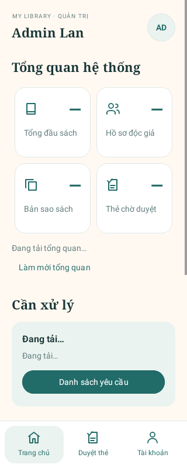

# Home Admin

Hoàn thiện giao diện Java/XML theo bố cục trang Admin trong PDF Figma người dùng cung cấp: thẻ thống kê bo góc, tiêu đề serif và các nhóm tổng quan/công việc/lối tắt. Theo yêu cầu đồng bộ màu tiếp theo, Home Admin dùng bảng màu chung của Login/Reader trong `colors.xml`, không dùng nền kem và bảng màu riêng. Xem [quy chuẩn màu](UI_COLORS.md).

Ảnh được render từ layout thật bằng Robolectric ở khung 320dp; tên trong ảnh là fixture kiểm thử, số liệu chưa tải được biểu diễn bằng dấu “—”. Đây không phải ảnh từ Firebase production.

## Giao diện và hành vi

- Trang chủ: thông tin Admin đã xác minh, thống kê tổng đầu sách, hồ sơ Reader, bản sao sách và thẻ chờ duyệt; nhóm công việc đăng ký/khôi phục; lối tắt vào luồng đã có.
- Duyệt thẻ: gom yêu cầu đăng ký và khôi phục mật khẩu vào trang riêng. Giữ nguyên xử lý duyệt/từ chối hiện tại, hiển thị loading/rỗng/lỗi/cache và nút làm mới.
- Tài khoản: tải hồ sơ Admin từ `Admins/{uid}`; hiển thị họ tên, ngày sinh, số điện thoại, email công vụ và vai trò. Cho phép cập nhật số điện thoại/email; đổi email yêu cầu xác minh lại bằng mật khẩu Firebase Auth rồi cập nhật hồ sơ Firestore. Có lối tắt đổi mật khẩu, đồng bộ danh mục, quản lý độc giả/cấu hình/báo cáo và đăng xuất. Avatar cũng mở mục này.
- Ba tab cố định dưới màn hình; giữ tab khi Activity được tạo lại; Back từ mục con quay về trang chủ. Bố cục cuộn, hỗ trợ insets thanh hệ thống và nhãn tiêu đề accessibility qua ViewCompat để tương thích minSdk 23.
- Giữ SessionActivity kiểm tra quyền server, dừng listener khi ra nền; bỏ kết quả thống kê/listener cũ khi phiên hoặc lần tải thay đổi. Không mở thêm Activity được exported.

## Nguồn số liệu

| Ô | Nguồn |
|---|---|
| Tổng đầu sách | `BookTitles.count()` từ server; gồm cả sách ẩn dành cho quản trị |
| Hồ sơ độc giả | `Users.whereEqualTo("role", "Reader").count()` từ server; số hồ sơ, không khẳng định tất cả thẻ đang hoạt động |
| Bản sao sách | `BookCopies.count()` từ server |
| Thẻ chờ duyệt / khôi phục | Các listener yêu cầu đang có và bộ lọc trạng thái hiện tại |

Lỗi đọc số liệu không được chuyển thành số 0. Thông tin cập nhật của yêu cầu phân biệt snapshot cache với server bằng MetadataChanges.INCLUDE. Nút làm mới khởi động lại việc tải tương ứng.

Các phần Figma như biểu đồ mượn, số Admin hoạt động, báo cáo thu phạt, quét/giao sách và cấu hình hệ thống chưa có đường gọi/quyền đọc hoàn chỉnh trong ứng dụng hiện tại. Không thêm số mẫu, biểu đồ giả hoặc nút không thực hiện được; các phân hệ đó cần triển khai nghiệp vụ riêng.

## File thay đổi

- `ui/admin/AdminMainActivity.java`: nối layout, số liệu tổng quan read-only, trạng thái yêu cầu, tab/back/insets; tải hồ sơ Admin từ Firestore, sửa thông tin liên hệ với xác minh Firebase Auth khi đổi email, và nối các hành động bảo mật/quản trị.
- `res/layout/activity_admin_main.xml`, `res/values/admin_strings.xml`: thiết kế lại tab Tài khoản theo nhóm Hồ sơ, Bảo mật & phiên đăng nhập và Công cụ quản trị.
- `ui/admin/AdminHomeView.java`: điều hướng giữa ba vùng và lối tắt; khôi phục tab.
- `res/layout/activity_admin_main.xml`: toàn bộ cấu trúc Home/Requests/Account và thanh điều hướng.
- `res/values/colors.xml`, `themes.xml`: bảng màu chung và theme sáng; `admin_strings.xml`, `admin_styles.xml`: nội dung và kiểu giao diện Admin. `admin_colors.xml` đã được bỏ.
- `res/drawable/bg_admin_{avatar,card,nav,soft}.xml`: nền thẻ/avatar/tab.
- `res/drawable/ic_admin_{account,arrow,book,check,copy,home,people,refresh}.xml`: icon vector.
- `src/test/.../ui/admin/AdminHomeViewTest.java`: mặc định không hiển thị số mẫu, tab/lối tắt/khôi phục, render khung nhỏ.
- `tools/firestore-tests/rules.test.cjs`: xác minh aggregation bằng quyền hiện tại và từ chối Reader liệt kê hồ sơ người khác.
- Tài liệu này và `docs/screenshots/admin-home.png`: ghi nhận phạm vi/ảnh xem trước.

## Kiểm thử thực tế

Ngày 21/10/2026:

- `:app:testDebugUnitTest :app:assembleDebug :app:lintDebug`: BUILD SUCCESSFUL; **48 test, 0 fail/error/skip**, APK debug tạo thành công.
- Lint: **0 lỗi, 204 cảnh báo**. Lỗi API accessibilityHeading trong lượt đầu đã sửa bằng ViewCompat, không tắt kiểm tra.
- Firestore emulator `demo-library-online`: **12/12 test đạt**, gồm aggregation cho Admin và từ chối Reader query toàn bộ Users.
- `git diff --check`: đạt.
- Đã xem ảnh render layout thật ở 320dp. Chưa thao tác trên thiết bị/Android emulator hoặc Firebase production; cần smoke test với tài khoản thật sau khi kéo mã.

Không thay schema, dependency, lockfile hoặc `firestore.rules`. Không deploy Firebase và không ghi/migration dữ liệu cloud. **Không cần cập nhật Rules cho thay đổi Home Admin này.**

## Kiểm tra sau khi đồng bộ màu

- Admin dùng trực tiếp `library_background`, `library_surface`, `library_text`, `library_muted`, `library_border` và màu thương hiệu `library_blue` có sẵn. Màu trạng thái chờ/từ chối/đăng xuất giữ nguyên giá trị và tập trung trong `colors.xml`.
- Các thẻ và khu vực nổi dùng surface trắng. Avatar/tab được chọn tái sử dụng các màu nền đã có; không tạo sắc nền mới.
- Theme khai báo surface, nền nổi và chữ dùng resource chung. Bỏ override DayNight trong `values-night/themes.xml` để các cấu hình đều dùng theme Light hiện có.
- Render Admin, Login, Reader ở 320dp với cấu hình `notnight` và `night`: nền cả ba là RGB(245,247,252), tức `#F5F7FC`; ảnh day/night của từng màn hình giống nhau trong phép so sánh pixel.
- Chạy lại toàn bộ 48 test Android, build debug và lint thành công. Chưa kiểm tra trực tiếp trên thiết bị thật.
- Không thay đổi Rules hoặc deploy Firebase.

## Tài khoản Admin theo thiết kế Figma

- Hồ sơ dùng dữ liệu document `Admins/{uid}` và email từ Firebase Authentication khi cần đối chiếu. Ngày sinh đọc lần lượt từ `dateOfBirth`, `birthDate` hoặc `dob` để tương thích hồ sơ hiện có; nếu chưa có dữ liệu, UI hiển thị “Chưa cập nhật”, không dựng dữ liệu mẫu.
- Sửa liên hệ cập nhật `phone`, `email`, `updatedAt`. Khi email thay đổi, yêu cầu mật khẩu hiện tại, reauthenticate Firebase Auth và cập nhật email Auth trước khi ghi hồ sơ. Nếu ghi Firestore thất bại, app thử rollback email Auth; nếu rollback cũng thất bại, phiên được đăng xuất và yêu cầu sửa hồ sơ thủ công để tránh tiếp tục bằng phiên không nhất quán.
- Đổi mật khẩu mở `AdminPasswordActivity`, tiếp tục kiểm tra phiên Admin và dùng Firebase Auth. Quyền Admin vẫn lấy từ `Admins/{uid}.adminStatus`; giao diện không thể tự cấp quyền.
- Chưa kiểm thử thao tác email thật với Firebase production sau thay đổi này; cần chạy build/test và smoke test trên thiết bị trước khi merge.
